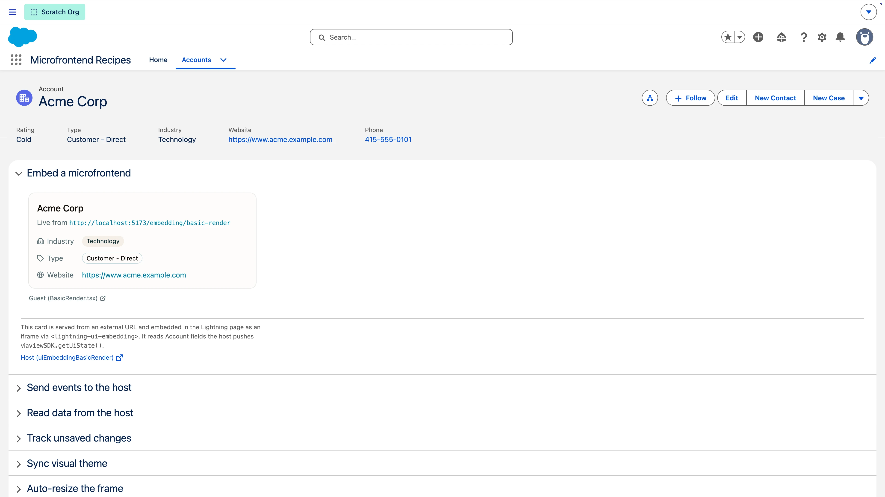
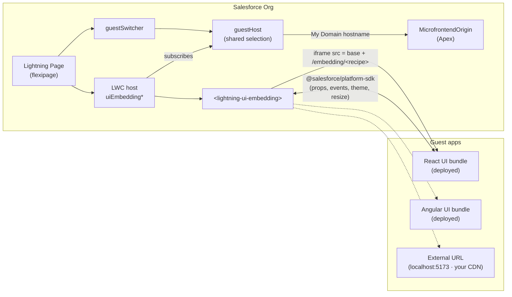

# Micro-Frontend Recipes



Recipes that show how to embed an externally hosted framework app into Salesforce via the standard `<lightning-ui-embedding>` base component. Each recipe is an LWC host component, deployed to the org, that embeds a small guest served on an `/embedding/*` route. Out of the box the guests are the [React](../react-recipes) and [Angular](../angular-recipes) UI bundles deployed to your org, so there is nothing to run locally. Most hosts pair with their own guest; the ready- and error-state recipes reuse the Basic Render guest to demonstrate host-side handling.

**Learn more:** Read the [Salesforce Micro-Frontend developer guide](https://developer.salesforce.com/docs/platform/microfrontend/guide/get-started.html) for a comprehensive overview.

## How the pieces fit together



- **LWC host components** (this package, under [`lwc/`](lwc/)) render `<lightning-ui-embedding src="...">`. They don't build the URL themselves: each subscribes to the shared [`guestHost`](lwc/guestHost) module for its recipe route.
- **Guest recipes** are written in whichever framework you like. In this repo they come from both the [React](../react-recipes) and [Angular](../angular-recipes) bundles — each under its own `src/**/recipes/embedding/` — and are served on `/embedding/*` routes.
- **The guest switcher** ([`guestSwitcher`](lwc/guestSwitcher)) sits above the accordion on the Account page. It picks **React** (the default), **Angular**, or an **External URL**, and every host on the page re-points to the choice. The selection is remembered in your browser.
- **Deployed guests live on a different origin.** UI bundles are served from the org's `*.my.salesforce.app` domain, not the Lightning domain, which is also what satisfies `<lightning-ui-embedding>`'s requirement that the guest be cross-origin. [`MicrofrontendOrigin`](classes/MicrofrontendOrigin.cls) returns the org's My Domain hostname (`DomainCreator.getOrgMyDomainHostname()`), and `guestHost` turns it into the bundle URL:

  ```text
  foo-dev-ed.scratch.my.salesforce.com
    → https://foo-dev-ed--c.scratch.my.salesforce.app/app/c__reactRecipes
  ```

- **No session banner in the card.** Each bundle's `public/embedded-session-banner.js` hides the platform's "Logged in as" banner when the app is framed.
- **In production,** you would deploy the framework app to your own hosting (Vercel, AWS, anywhere) and repoint the hosts in code (`getGuestBase` in `guestHost`). **External URL** is a per-browser option for development and testing; it isn't an org-wide setting.

**Use when:** you already have an externally hosted app you want to reuse across Salesforce and non-Salesforce surfaces.

> To install and deploy, follow [Setting up a Scratch Org](../../../README.md#setting-up-a-scratch-org) in the root README — it deploys the host components, their Lightning pages and the React and Angular bundles along with every other recipe app. That guide includes one extra step, `npm run setup:mfe-csp`, described next.

## Trusting the guest origin

The Lightning page may only frame origins that a CSP Trusted Site allows (`frame-src`). The deployed guests' origin is different for every org, so it can't ship as static metadata. A wildcard such as `https://*.my.salesforce.app` would let pages in your org embed UI bundles from _any_ org, so don't use one. Instead, after deploying, run:

```bash
npm run setup:mfe-csp
```

The script ([`scripts/setup-mfe-csp.mjs`](../../../scripts/setup-mfe-csp.mjs)) derives your org's guest origin from `sf org display` and deploys a single trusted site for exactly that origin. Pass `-- --target-org <alias>` to target an org other than your default. It is safe to re-run.

Then open the org and select the **Micro-Frontend Recipes** app in App Launcher. The app landing page is a banner that jumps to a demo Account. Within this app, Account record pages are overridden with `Microfrontend_Recipes_Account.flexipage` — the guest switcher followed by an accordion of the ten recipes; every other app shows the stock Account page.

## Choosing a guest

Use the **Guest app** switcher at the top of the Account page:

| Option           | Embeds                                                                                 | Needs                                                                  |
| ---------------- | -------------------------------------------------------------------------------------- | ---------------------------------------------------------------------- |
| **React**        | The `reactRecipes` bundle deployed to this org (default)                               | The normal deploy, plus `npm run setup:mfe-csp`                        |
| **Angular**      | The `angularRecipes` bundle deployed to this org                                       | The normal deploy, plus `npm run setup:mfe-csp`                        |
| **External URL** | Whatever you enter, e.g. `http://localhost:5173` (the default) or your own CDN/hosting | A CSP trusted site for that URL (`localhost:5173` ships with the repo) |

The switcher shows the base URL the guests are currently loaded from. If it says it couldn't resolve the org's domain, check that your user has the **Micro-Frontend Recipes** permission set (it grants access to `MicrofrontendOrigin`; the **Recipes (All Frameworks)** group includes it), then reload the page.

## Local Development

Each recipe has two moving parts you iterate on separately.

### Guests (React or Angular)

To iterate on a guest with hot reload, start a framework's dev server and point the switcher at it:

1. Start the dev server from the repository root — it serves the guest recipes under `/embedding/*` on `http://localhost:5173`:
   - **React** — `npm run dev:react` (see [React Recipes → Local Development](../react-recipes/README.md#local-development))
   - **Angular** — `npm run dev:angular` (see [Angular Recipes → Local Development](../angular-recipes/README.md#local-development))
2. On the Account page, choose **External URL**. It's prefilled with `http://localhost:5173`. The repo ships a CSP trusted site for that address ([`MicrofrontendRecipesLocalhost`](cspTrustedSites/MicrofrontendRecipesLocalhost.cspTrustedSite-meta.xml)).

Guests live under `src/recipes/embedding/` in the React bundle and `src/app/recipes/embedding/` in the Angular bundle. Changes to a deployed guest need a rebuild and redeploy (`npm run build`, then `sf project deploy start --source-dir force-app`).

### Hosts (LWC)

Hosts are deployed to the org. After editing a component under `lwc/`, redeploy it:

```bash
sf project deploy start --source-dir force-app/main/microfrontend-recipes
```

## Testing

### Host components (LWC)

Covered by [sfdx-lwc-jest](https://github.com/salesforce/sfdx-lwc-jest). Run from the repository root:

```bash
npm run test:unit
```

Run with coverage:

```bash
npm run test:unit:coverage
```

### Guest recipes (React or Angular)

Guests are covered by their framework's test suite — see [React Recipes → Testing](../react-recipes/README.md#testing) or [Angular Recipes → Testing](../angular-recipes/README.md#testing).

### Embedding in an org

Checks that the React and Angular guests render embedded in the Account page of a deployed org. It needs the app deployed and `npm run setup:mfe-csp` run, and it uses Playwright from the React bundle (`npx playwright install chromium` there if needed):

```bash
npm run test:mfe-embedding
```

CI runs it against a scratch org. Pass `-- --target-org <alias>` to use an org other than your default.
